

<!-- ========================================================================================= -->
<!--      SVG I. THE VIGIL OF THE SLEEPING LAMBS (DARK WOODCUT & ANIMATED BOUNDARY SVG)        -->
<!-- ========================================================================================= -->
<picture>
  <source media="(prefers-color-scheme: dark)" srcset="./assets/dex_heraldry_banner.svg">
  <source media="(prefers-color-scheme: light)" srcset="./assets/dex_heraldry_banner.svg">
  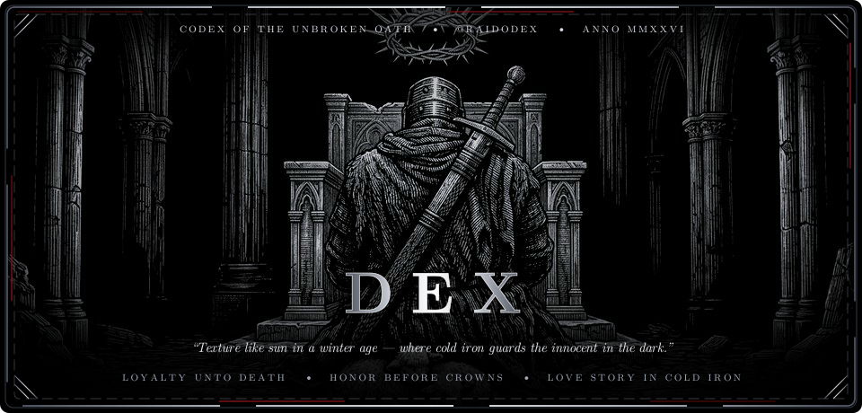
</picture>

 

<!-- ========================================================================================= -->
<!--          SVG II. THE FOUR GOTHIC ARCHES OF THE OATH (WOODCUT FRIEZE SVG)                  -->
<!-- ========================================================================================= -->
<picture>
  <source media="(prefers-color-scheme: dark)" srcset="./assets/dex_oath_banners.svg">
  <source media="(prefers-color-scheme: light)" srcset="./assets/dex_oath_banners.svg">
  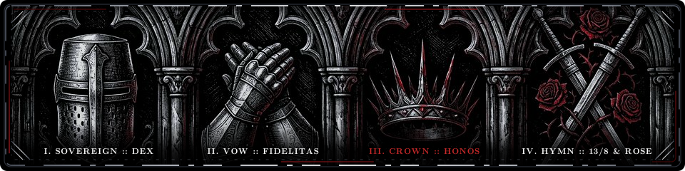
</picture>

 

  <a href="#the-helm"><code>⚔️ The Helm</code></a> &nbsp;•&nbsp;
  <a href="#the-triptych"><code>🗡️ The Triptych</code></a> &nbsp;•&nbsp;
  <a href="#the-codex"><code>🥀 The Codex</code></a> &nbsp;•&nbsp;
  <a href="#the-tenets"><code>📜 The Tenets</code></a> &nbsp;•&nbsp;
  <a href="#memento-mori"><code>💀 Memento Mori</code></a> &nbsp;•&nbsp;
  <a href="#the-hymns"><code>🎻 The Hymns</code></a> &nbsp;•&nbsp;
  <a href="#the-apocrypha"><code>📖 The Apocrypha</code></a> &nbsp;•&nbsp;
  <a href="#the-sanctuary"><code>🏰 Sanctuary</code></a>

> *“Throughout the night, no need to fight — on her ship, tied to the mast...”*  
> *“We were both young when I first saw you... standing there on a balcony in summer air.”*

 

<!-- ========================================================================================= -->
<!--                            COLD-IRON GOTHIC FRIEZE DIVIDER                                -->
<!-- ========================================================================================= -->

  <picture>
    <source media="(prefers-color-scheme: dark)" srcset="./assets/dex_gothic_divider.svg">
    <source media="(prefers-color-scheme: light)" srcset="./assets/dex_gothic_divider.svg">
    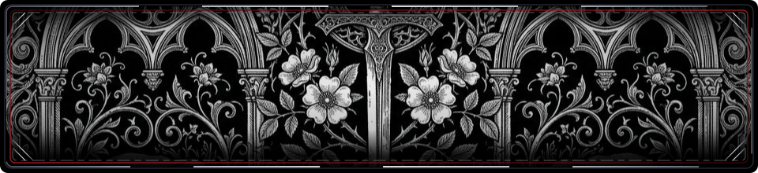
  </picture>

 

## `I.` ⚔️ The Silence Beneath the Great Helm

Look closely at the knight who kneels in the pitch-black nave. A scarred broadsword is strapped across his back, and a jagged iron halo of thorns hangs above his brow—yet **two small lambs sleep unafraid against his armored knees**.

That is the entire philosophy of **DEX** ([`@raidodex`](https://github.com/raidodex)).

True strength is never loud, and it never preys upon the gentle. The world is full of hollow men who wear paper crowns, trade their banners when the wind shifts, and mistake cruelty for power. **I live by the older law**: that a man’s worth is measured by the weight of the promise he keeps when no one is watching, the innocence his cold iron protects, and the loyalty that refuses to yield even when the throne room lies in ash.

My soul is tuned to two eternal frequencies: the **13/8 harpsichord trance of *Golden Brown***—ancient, unhurried, and serene amidst the tempest—and the **defiant romance of *Love Story***, where two souls bound by silver fate-threads stand against an entire kingdom’s decree.

 

<!-- ========================================================================================= -->
<!--        SVG III. THE ETERNAL MARCH OF COLD IRON (PILGRIMAGE ACROSS THE ABYSS SVG)          -->
<!-- ========================================================================================= -->

  <picture>
    <source media="(prefers-color-scheme: dark)" srcset="./assets/dex_ascii_knight_walk.svg">
    <source media="(prefers-color-scheme: light)" srcset="./assets/dex_ascii_knight_walk.svg">
    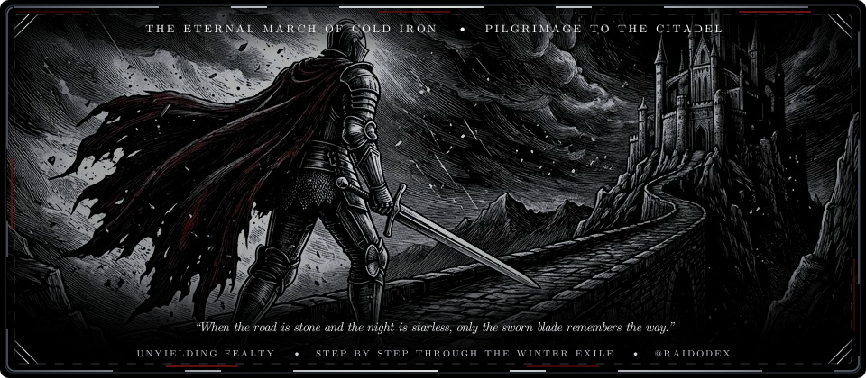
  </picture>

 

## `II.` 🗡️ The Three Engravings — *Loyalty, Honor & Devotion*

<!-- ========================================================================================= -->
<!--           SVG IV. THREE-PANEL WOODCUT TRIPTYCH (LOYALTY, HONOR, DEVOTION)                 -->
<!-- ========================================================================================= -->

  <picture>
    <source media="(prefers-color-scheme: dark)" srcset="./assets/dex_arcana_triptych.svg">
    <source media="(prefers-color-scheme: light)" srcset="./assets/dex_arcana_triptych.svg">
    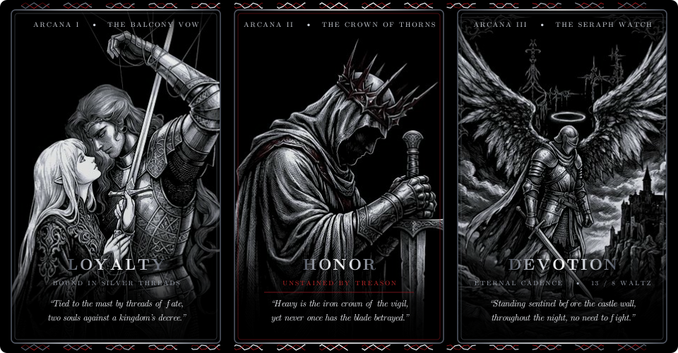
  </picture>

 

<table width="100%">
  <thead>
    <tr>
      <th align="center" width="33%">🩸 I. The Silver Threads (Loyalty)</th>
      <th align="center" width="34%">👑 II. The Crimson Crown (Honor)</th>
      <th align="center" width="33%">🪽 III. The Seraph Watch (Devotion)</th>
    </tr>
  </thead>
  <tbody>
    <tr>
      <td valign="top" align="center">
        <b><i>“Bound by threads that no exile can sever.”</i></b>
          
        Like strings of a harpsichord descending from the void, true loyalty binds two hands around the same hilt. Anyone can pledge fealty during the banquet; only the faithful remain when the world forbids the vow and the road leads into the dark.
      </td>
      <td valign="top" align="center">
        <b><i>“Heavy is the iron crown of conscience.”</i></b>
          
        Honor is not the applause of the court—it is the jagged crown of thorns you wear willingly so your word remains unbroken. Better to kneel in the ash with an unstained blade than to rule an empire won by deceit.
      </td>
      <td valign="top" align="center">
        <b><i>“Standing sentinel before the distant turret.”</i></b>
          
        <i>“Throughout the night, no need to fight...”</i> Under a winter sky, the winged watchman keeps his post on the crag while the citadel sleeps. Devotion is the quiet vigil that asks for no reward.
      </td>
    </tr>
  </tbody>
</table>

 

## `III.` 🥀 The Obsidian Codex — *The Blade & The Five-Petaled Rose*

<!-- ========================================================================================= -->
<!--     SVG V. THE OBSIDIAN CODEX (LONGSWORD ENTWINED WITH FIVE-PETALED GOTHIC ROSES)         -->
<!-- ========================================================================================= -->

  <picture>
    <source media="(prefers-color-scheme: dark)" srcset="./assets/dex_armory_ledger.svg">
    <source media="(prefers-color-scheme: light)" srcset="./assets/dex_armory_ledger.svg">
    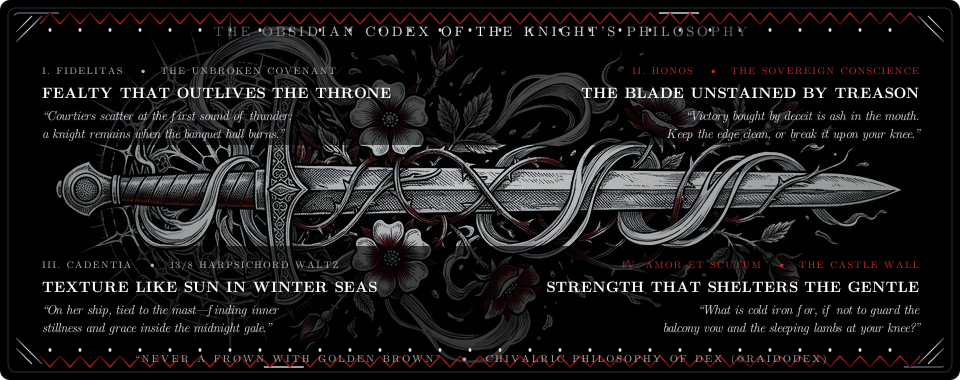
  </picture>

 

<!-- ========================================================================================= -->
<!--                            COLD-IRON GOTHIC FRIEZE DIVIDER                                -->
<!-- ========================================================================================= -->

  <picture>
    <source media="(prefers-color-scheme: dark)" srcset="./assets/dex_gothic_divider.svg">
    <source media="(prefers-color-scheme: light)" srcset="./assets/dex_gothic_divider.svg">
    
  </picture>

 

## `IV.` 📜 The Six Tenets of the Obsidian Vigil

<!-- ========================================================================================= -->
<!--      SVG XI. THE SIX TENETS (SOLITARY KNIGHT KNEELING BEFORE THE MOONLIT ALTAR SVG)       -->
<!-- ========================================================================================= -->

  <picture>
    <source media="(prefers-color-scheme: dark)" srcset="./assets/dex_tenets_vigil.svg">
    <source media="(prefers-color-scheme: light)" srcset="./assets/dex_tenets_vigil.svg">
    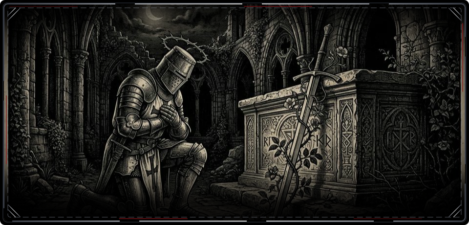
  </picture>

 

1. **⚔️ The Broadsword Exists Only for the Sleeping Lambs.** Power without mercy is monsterhood. You wear the heavy mail, endure the freezing rain, and carry the steel across your back for one reason alone: so that what is innocent, gentle, and sacred may rest beside you without fear.
2. **🩸 Loyalty Is a Covenant Written in Bone, Not Ink.** Fair-weather allies calculate the cost before they draw their sword. When I give my word, the calculation is over—come siege, famine, or exile, the banner does not come down.
3. **👑 Wear the Crown of Thorns Before the Crown of Gold.** Never trade your conscience for an easy victory. A man who betrays his principles to win the throne is still a beggar in royal robes; a man who keeps his honor in defeat remains a king.
4. **🎻 Move to the 13/8 Cadence of *Golden Brown*.** While the world rushes in frantic, shallow beats, keep an ancient rhythm inside your chest—steady as a harpsichord in a stone cathedral, calm as a ship lashed to the mast while the winter sea rages.
5. **🌹 Defend the Balcony Against Every Cynic in the Realm.** In every age, the bitter and the broken will tell you that romance is dead and chivalry is folly. Let them talk in the mud; keep your eyes on the turret light and your promise unbroken.
6. **💀 Remember the Skull Question (*Memento Mori*).** Every crown eventually turns to dust, and every fortress crumbles back into the cliff. When the final question is asked of your life, only two things will answer: **whom you loved, and whether you kept your word.**

 

## `V.` 💀 The Final Interrogation — *Memento Mori*

<!-- ========================================================================================= -->
<!--           SVG VI. MEMENTO MORI (ANATOMICAL SKULL QUESTION MARK WOODCUT SVG)               -->
<!-- ========================================================================================= -->

  <picture>
    <source media="(prefers-color-scheme: dark)" srcset="./assets/dex_memento_mori.svg">
    <source media="(prefers-color-scheme: light)" srcset="./assets/dex_memento_mori.svg">
    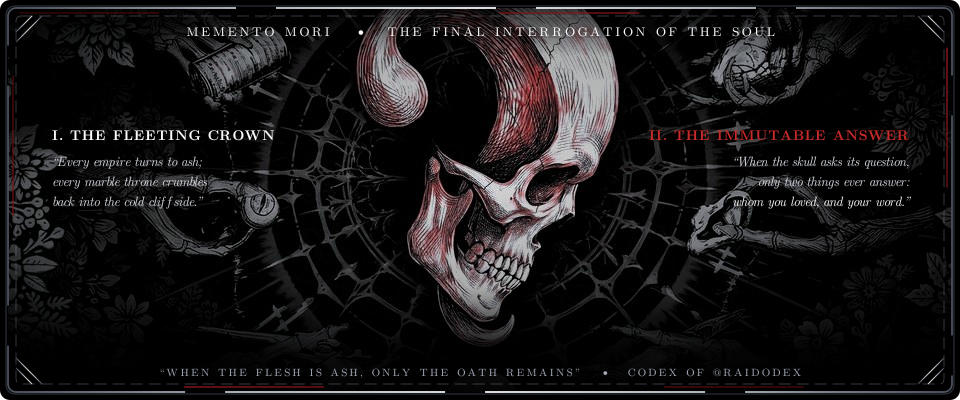
  </picture>

 

## `VI.` 🎻 The Two Hymns of the Sanctuary *(13/8 & The Balcony)*

<!-- ========================================================================================= -->
<!--         SVG VII. HYMN I — THE 13/8 HARPSICHORD TRANCE & SHIP TIED TO THE MAST             -->
<!-- ========================================================================================= -->

  <picture>
    <source media="(prefers-color-scheme: dark)" srcset="./assets/dex_golden_brown_score.svg">
    <source media="(prefers-color-scheme: light)" srcset="./assets/dex_golden_brown_score.svg">
    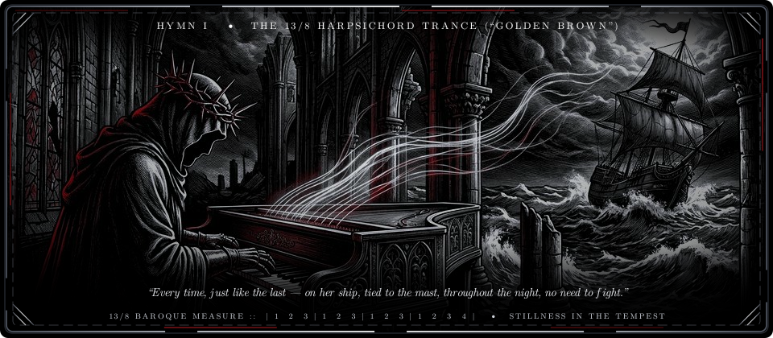
  </picture>

 

> *“Every time, just like the last / On her ship, tied to the mast / To distant lands, takes both my hands...”*  
> There is an hour between midnight and dawn when the noise of the century dies away. That is the hour of the harpsichord—a state of serene, unshakeable clarity where time shifts out of the common march into a timeless waltz, and the soul remembers what it was built to endure.

  <a href="https://open.spotify.com/track/2AX5E86cxQfmUsBkKc4KNv"><code>▶️ Spotify: The Stranglers — Golden Brown</code></a> &nbsp;•&nbsp;
  <a href="https://www.youtube.com/results?search_query=the+stranglers+golden+brown+official+video"><code>🏛️ YouTube: The 13/8 Harpsichord Sanctuary</code></a>

 

<!-- ========================================================================================= -->
<!--         SVG VIII. HYMN II — THE VERONA BALCONY DEFIANCE (LOVE STORY WOODCUT)              -->
<!-- ========================================================================================= -->

  <picture>
    <source media="(prefers-color-scheme: dark)" srcset="./assets/dex_love_story_balcony.svg">
    <source media="(prefers-color-scheme: light)" srcset="./assets/dex_love_story_balcony.svg">
    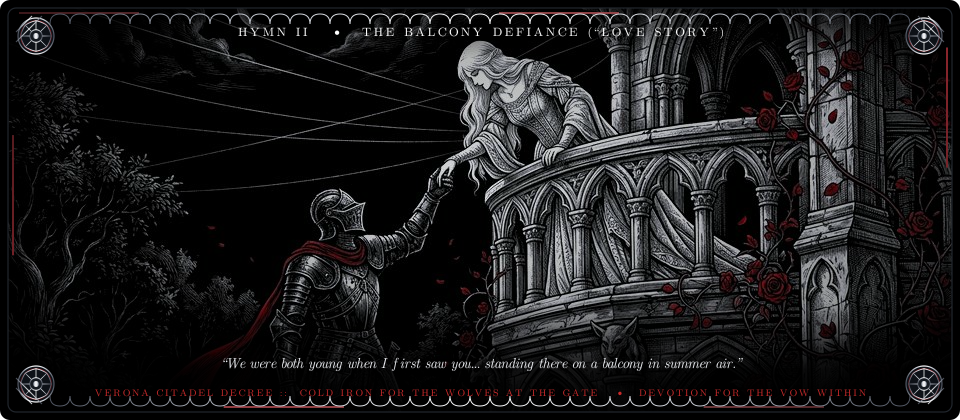
  </picture>

 

> *“Romeo, take me somewhere we can be alone / I’ll be waiting, all there’s left to do is run / You’ll be the prince and I’ll be the princess...”*  
> Beneath every suit of blackened plate armor beats the oldest story in human memory: the refusal to let fear, exile, or forbidden gates sever a sworn devotion. A knight without romance is merely a mercenary; it is the promise waiting on the castle balcony that turns cold steel into a sacred calling.

  <a href="https://open.spotify.com/track/1D4PL9B8gOgVN8Fvzgv9S1"><code>▶️ Spotify: Taylor Swift — Love Story</code></a> &nbsp;•&nbsp;
  <a href="https://www.youtube.com/results?search_query=taylor+swift+love+story+official+music+video"><code>🏰 YouTube: The Verona Balcony Defiance</code></a>

 

## `VII.` 📖 The Sealed Apocrypha of the Unspoken Vow

  
<b>📜 <i>Click to Break the Wax Seal & Unroll the Ancient Parchment...</i></b>

   

<!-- ========================================================================================= -->
<!--       SVG XII. THE ANCIENT GRIMOIRE (CODEX OF ILLUMINATED SIGILS & ROSE SVG)             -->
<!-- ========================================================================================= -->
  

    <picture>
      <source media="(prefers-color-scheme: dark)" srcset="./assets/dex_grimoire_codex.svg">
      <source media="(prefers-color-scheme: light)" srcset="./assets/dex_grimoire_codex.svg">
      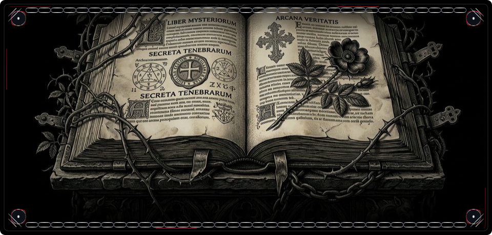
    </picture>
  

   

  <blockquote>
    
<b>From the Marginalia of the Iron Psalter:</b> 
    <i>“There are promises that can never be spoken in the daylight of courts, lest the pretenders demand their tribute. We carve them into bone beneath the gauntlet. We sing them in the cadence of fifteen beats where the world only counts twelve. When the fortress falls and the banners burn, look not to the gilded crown in the dust, but to the lantern burning in the high turret window. That is where the oath endures—unyielding, unstained, and eternal.”</i>

  </blockquote>

  <table width="100%">
    <thead>
      <tr>
        <th align="center" width="50%">🕯️ The Silent Watch</th>
        <th align="center" width="50%">🩸 The Unbroken Seal</th>
      </tr>
    </thead>
    <tbody>
      <tr>
        <td valign="top" align="center">
          <i>“While the citadel sleeps, the iron halo keeps watch against the abyss.”</i>  
          No compromise with falsehood. No quarter given to betrayal. Let the winter storm strike the stone—the lamp remains lit.
        </td>
        <td valign="top" align="center">
          <i>“Written in cold steel, sealed in red wax, remembered unto the dust.”</i>  
          To protect what is innocent, to love what is true, and to stand immovable when all others turn away.
        </td>
      </tr>
    </tbody>
  </table>

 

<!-- ========================================================================================= -->
<!--                            COLD-IRON GOTHIC FRIEZE DIVIDER                                -->
<!-- ========================================================================================= -->

  <picture>
    <source media="(prefers-color-scheme: dark)" srcset="./assets/dex_gothic_divider.svg">
    <source media="(prefers-color-scheme: light)" srcset="./assets/dex_gothic_divider.svg">
    
  </picture>

 

## `VIII.` 🏰 The Sovereign Vigil & The Final Rest of the Blade

<!-- ========================================================================================= -->
<!--       SVG IX. THE FALLEN THRONE (ENTHRONED WINGED KNIGHT-KING WOODCUT SVG)                -->
<!-- ========================================================================================= -->

  <picture>
    <source media="(prefers-color-scheme: dark)" srcset="./assets/dex_fallen_throne.svg">
    <source media="(prefers-color-scheme: light)" srcset="./assets/dex_fallen_throne.svg">
    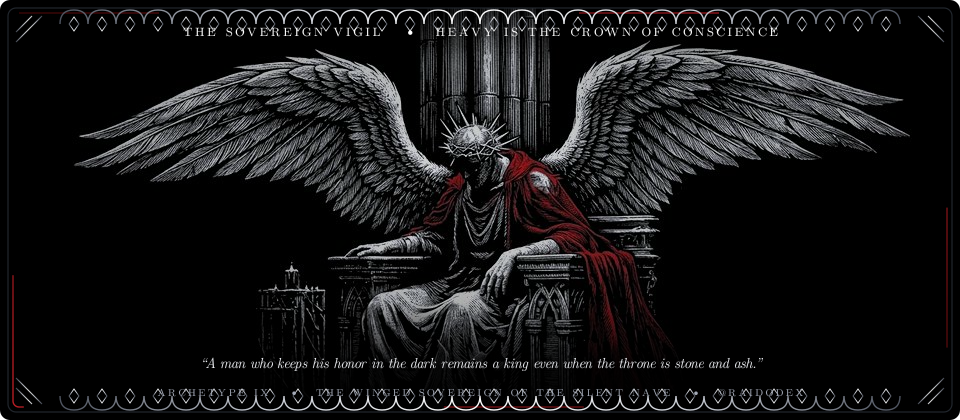
  </picture>

 

| ⚔️ **Sovereign** | 🩸 **Watchword** | 🏰 **Sanctuary** |
| :---: | :---: | :---: |
| **DEX** ([`@raidodex`](https://github.com/raidodex)) | *“Loyalty Unto Death • Honor Before Crowns”* | [**github.com/raidodex**](https://github.com/raidodex) |

 

<!-- ========================================================================================= -->
<!--      SVG X. THE FINAL SANCTUARY (GREATSWORD PLANTED IN WHITE LILIES & CRIMSON ROSES)      -->
<!-- ========================================================================================= -->
<picture>
  <source media="(prefers-color-scheme: dark)" srcset="./assets/dex_wax_seal.svg">
  <source media="(prefers-color-scheme: light)" srcset="./assets/dex_wax_seal.svg">
  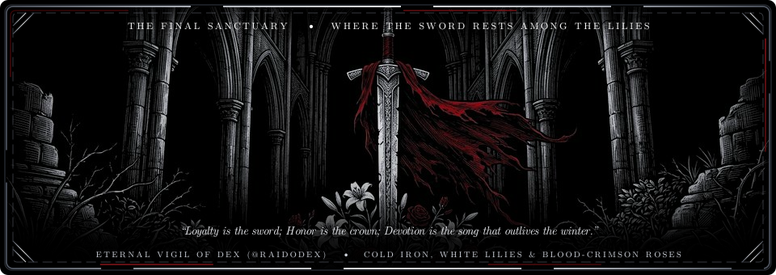
</picture>

